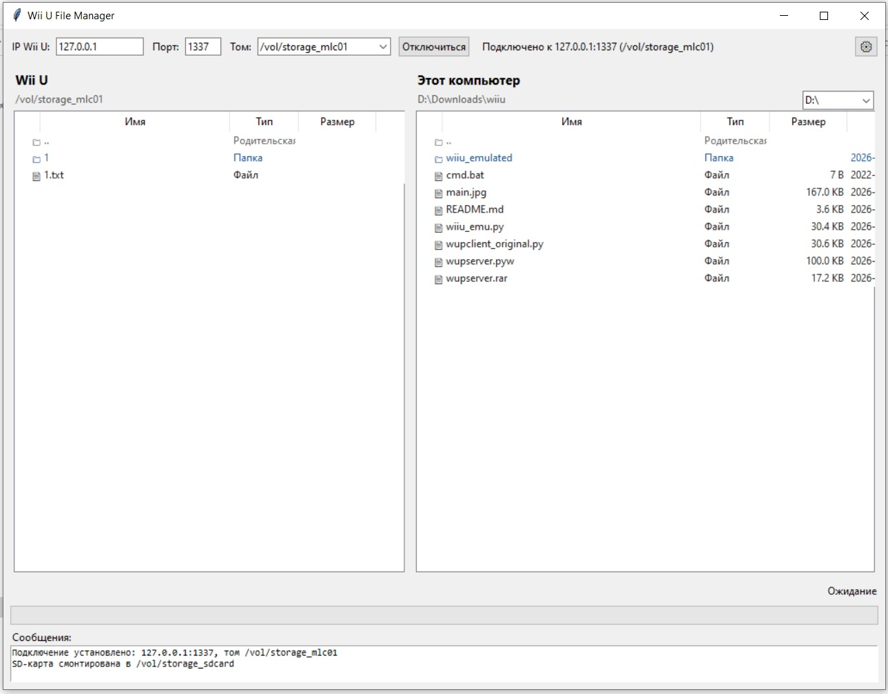

# Wii U File Manager

Двухпанельный файловый менеджер для Wii U, работающий через `wupserver` (порт 1337). Позволяет подключаться к приставке по сети и работать с её файловой системой так же удобно, как в обычном файловом менеджере на ПК.

A two-panel file manager for the Wii U that talks to `wupserver` (port 1337). Connect to the console over the network and work with its filesystem as conveniently as with a desktop file manager.

### Возможности

- **Подключение к Wii U по IP и порту** (по умолчанию `192.168.3.1:1337`).
- **Выбор тома** при подключении:
  - `/vol/storage_mlc01` — внутренняя память (запись);
  - `/vol/storage_usb01` — USB-накопитель (запись);
  - `/vol/storage_sd01` — SD-карта (запись);
  - `/vol/system_slc` — системный раздел (только чтение).
- **Две панели**: Wii U и локальный компьютер.
- **Копирование файлов и папок в обе стороны** с прогресс-баром, скоростью и ETA.
- **Рекурсивное копирование папок** — как при скачивании, так и при загрузке.
- **Множественный выбор** файлов (Ctrl/Shift-клик, Ctrl+A) и пакетные операции.
- **Создание папок** на Wii U и локально.
- **Удаление** файлов и папок на Wii U и на ПК (с рекурсивным удалением содержимого).
- **Переименование** файлов и папок на обеих панелях.
- **Навигация** по папкам двойным кликом, кнопка «Вверх».
- **Переключение диска** на локальной панели.
- **Сортировка** по имени, типу, размеру, дате изменения (клик по заголовку).
- **Раздельная группировка**: сначала папки по имени, затем файлы по имени.
- **Контекстное меню (правый клик)** на обеих панелях.
- **Горячие клавиши**:
  - `F5` — обновить обе панели;
  - `F7` — новая папка на Wii U;
  - `Delete` — удалить в активной панели;
  - `Enter` — открыть/скачать/загрузить;
  - `F2` — переименовать;
  - `Ctrl+A` — выделить всё.
- **Прогресс-бар** с процентом, скоростью и оставшимся временем.
- **Журнал сообщений** с подробным логированием каждой операции (что, куда, сколько байт, за сколько секунд).
- **Сохранение настроек** (IP, порт, том, локальная папка) в `~/.wiiu_file_manager.json`.
- **Heartbeat и автоматическое переподключение** при потере связи с приставкой.
- **Опция проверки MD5** после скачивания.
- **Логирование в файл** (опционально).
- **Отмена копирования** кнопкой «Отключиться» во время операции (безопасно закрывает файл на Wii U).

